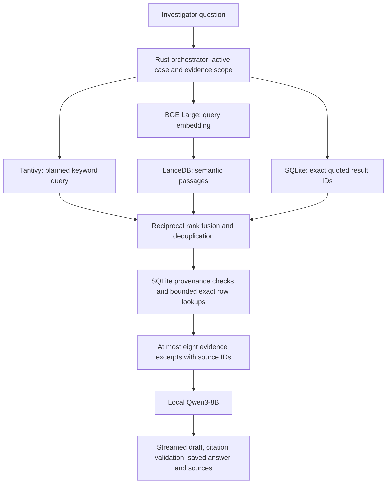

# Local case chat

Open **Chat** from the workspace sidebar. The conversation view includes saved case history, a multiline composer, streaming replies, stop, copy, an evidence-category scope and inspectable source cards. Conversations and source snapshots are stored alongside the case index in `chat.sqlite`, not in browser storage. The history list shows the most recent 100 conversations; opening one loads its most recent 200 messages. Deleting a conversation requires confirmation and does not modify original evidence.

## Setup

1. Download **Qwen3-8B (Q4_K_M)** in Settings → Models. The official GGUF is approximately 5.03 GB, pinned to revision `7c41481f57cb95916b40956ab2f0b139b296d974` and checked with SHA-256 by the existing model manager. Interrupted downloads can be resumed. Chat never downloads model weights automatically.
2. Index the active case. For semantic retrieval, also download BGE Large and enable Semantic indexing in Settings. Chat can fall back to keyword retrieval with an explicit notice when semantic retrieval is unavailable.
3. Ask a case-specific question. Click a citation or source card to inspect its original record identity, path, retrieval methods and readable excerpt.

First generation provisions a dedicated uv/Python 3.12 environment. Windows x64 systems with an NVIDIA GPU use a checksum-pinned CUDA 12.8 build of the maintained JamePeng llama-cpp-python fork (0.3.40), plus pinned NVIDIA cuBLAS/CUDA runtime packages. No system CUDA toolkit or compiler is required. The wheel selects a compatible CPU instruction backend at runtime, avoiding the unsupported-instruction failure observed with upstream CUDA wheels on Ryzen 5900X. CPU-only Windows systems retain the portable upstream 0.3.19 runtime; other platforms retain their existing CPU provisioning.

CUDA generation requests all model layers, enables GPU KV operations and flash attention, and verifies the backend's actual offloaded-layer report before accepting the worker as ready. Missing, partial or unconfirmed GPU offloading produces an explicit error rather than silently falling back to CPU. The worker keeps Windows DLL-directory handles alive and loads llama/GGML from the same packaged directory so they share one backend registry. Chat reports the detected device when generation starts. The context remains 8192 tokens, with prompt batches of 256, physical batches of 128 and four CPU support threads. Provisioning dependencies needs connectivity; inference runs locally without a model service or evidence uploads. Model weights remain manually downloaded and are reused. The model process is reused between turns and released when the active case changes.

## Retrieval architecture

Planning is deterministic query preparation, not arbitrary model-generated SQL. SQLite verifies artifact IDs against the latest completed parser jobs and confirms their source paths. Small source rows are read exactly; large results retain their matching indexed excerpts. Reranking uses reciprocal rank fusion, not a separately downloaded neural reranker. Evidence scope currently means the active case and selected category (all, artifacts, file content or metadata), rather than unrestricted temporal/spatial SQL analysis.

Artifacts retain result IDs, original row indices and paths. LanceDB hits expose their original group identity for exact verification. Stale artifact references are excluded. Answers retain their retrieval warnings and source snapshots so they can be reviewed later even if the index changes.

The generator treats evidence and history as untrusted data. ChatML control tokens in that data are escaped, thinking is disabled, context is token-counted, and older history is removed before source excerpts if the budget is exceeded. The worker reports which evidence IDs actually fit the prompt. Rust withholds completed answers with missing or unknown citation IDs. Citation validation proves only that references identify supplied evidence; it does not prove that a claim is entailed. Investigators must verify generated claims against original records.

The model cannot run commands, generate/exercise SQL, open files or browse. Chat history is context, not evidence. No-evidence retrieval returns an explicit limitation without generation; absence from a retrieved sample is not proof of absence from the case. Cancellation during retrieval or generation stops the request; the shared vector worker can resume its checkpointed reconciliation after restarting.

## Validation boundary

Tests cover rank fusion, citation whitelisting, exact SQLite verification, stale artifact rejection, per-case history persistence, prompt role boundaries, token budgets, GPU offload validation and safe UI rendering. Browser fixtures cover streaming, source inspection, stop, new/history conversations, deletion confirmation and case switching. A real Windows smoke test with the downloaded Qwen3-8B Q4_K_M model on RTX 4070 SUPER confirmed 37/37 layers offloaded to CUDA and streamed a correctly cited synthetic-evidence answer (approximately 65 tokens/second in this short test). This validates GPU generation and the worker protocol; retrieval-answer quality still requires representative case questions, and throughput varies with context size and competing GPU workloads.

Sources: [Official Qwen3-8B GGUF](https://huggingface.co/Qwen/Qwen3-8B-GGUF), [llama-cpp-python](https://llama-cpp-python.readthedocs.io/en/stable/), [pinned CUDA runtime release](https://github.com/JamePeng/llama-cpp-python/releases/tag/v0.3.40-cu128-win-20260608), [dynamic CPU backend support](https://github.com/JamePeng/llama-cpp-python#installation).
